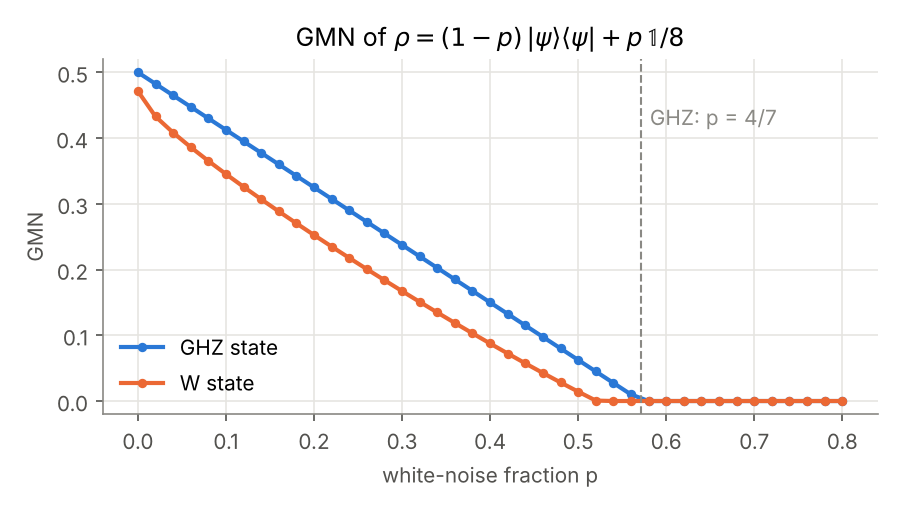
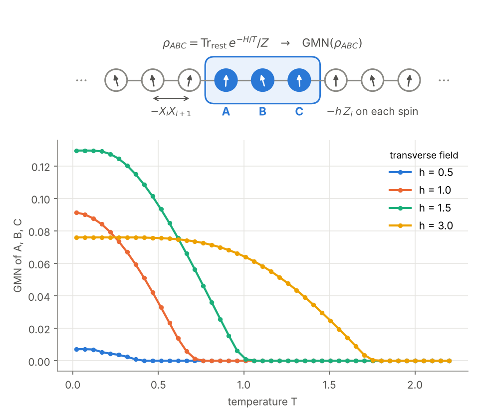

# Multipartite Entanglement Detection Toolkit (MEDT)

*Why I built this.* A lot has been written about multipartite entanglement, but the tools to detect and measure it are scattered across many papers, each with its own conventions and code. I wanted to bring them together in one framework, make them easy to use, and show that they are new and interesting probes of many-body physics.

Python tools to certify and quantify entanglement in multipartite quantum states, from small benchmark states to reduced density matrices of many-body systems.

```python
import numpy as np
import medt

ghz = np.zeros((8, 8)); ghz[np.ix_([0, 7], [0, 7])] = 0.5
rho = 0.7 * ghz + 0.3 * np.eye(8) / 8   # GHZ state with 30% white noise

medt.gmn(rho)                     # genuine multiparticle negativity, > 0 certifies GME
medt.gmc_x_state(rho)             # exact genuine multipartite concurrence (X states)
medt.ring_inflation_robustness(rho, [2, 2, 2])   # < 1 certifies network entanglement too
```

Sweeping the noise shows how much of it genuine multipartite entanglement (GME) survives. The GMN of the GHZ state drops linearly and is zero beyond 4/7 noise; the W state loses it a little earlier.

<p align="center"></p>

The same tools apply to many-body systems. Take three neighbouring spins A, B, C of the infinite transverse-field Ising chain in thermal equilibrium at temperature T. `medt.tfim` gives their exact reduced density matrix, and the GMN tells whether the three spins are still genuinely entangled with each other:

```python
for T in (0.2, 0.5, 1.0):
    rho_abc = medt.tfim.tfim_rdm(1.0, [0, 1, 2], beta=1 / T)   # critical field h = 1
    print(T, medt.gmn(rho_abc))                                # 0.081, 0.036, 0
```

Heat washes out the GME, and it does not fade away slowly: it vanishes at a finite temperature, a "sudden death" whose temperature depends on the field h.

<p align="center"></p>

[`docs/figures/make_readme_figures.py`](docs/figures/make_readme_figures.py) makes both figures in about 20 seconds.

For a guided tour with explanations and plots, see [`examples/medt_tour.ipynb`](examples/medt_tour.ipynb). It covers bipartite negativity, GME detection on noisy GHZ states, concurrence bounds, entanglement in the Ising chain, network entanglement, and entanglement microscopy of a 20-spin Lanczos ground state, and runs in a few minutes. [`examples/medt_fermions.ipynb`](examples/medt_fermions.ipynb) explains what changes for fermions (exchange signs, parity conservation) and compares fermionic and bosonic negativity and GMN; it runs in under a minute.

## Background

MEDT grew out of the author's PhD thesis, *Multipartite entanglement in quantum matter* (Université de Montréal, 2026), [doi:10.71781/34784](https://doi.org/10.71781/34784). Only the abstract is in French, and its English version follows right after. The research articles that make up the thesis are in English. The thesis builds "entanglement microscopy", which takes reduced density matrices from large-scale numerics and tests them with certified entanglement diagnostics. Its parts line up with the toolkit like this: Ising criticality [14] uses `negativity`, `gmn`, `gmc_*` and `medt.tfim`; quantum spin liquids [13] and beyond-Landau criticality [24] use `gmn`; and genuine network multipartite entanglement [15] uses `ring_inflation_robustness` and `gilbert_criterion`.

## Install

MEDT needs Python 3.10 or newer. Clone the repository and install it into a fresh environment:

```bash
git clone https://github.com/liukeLyu/multipartite-entanglement-detection-toolkit.git
cd multipartite-entanglement-detection-toolkit
python -m venv .venv && source .venv/bin/activate
pip install .                # core: numpy, scipy, cvxpy (with the Clarabel and SCS solvers)
pip install ".[examples]"    # optional: Jupyter and matplotlib for the tour notebook

# optional: PICOS + QICS, needed only for gmre
pip install ".[rains]"
```

## Usage

Every function takes a density matrix as a NumPy array and, where needed, the list of local dimensions. The snippets below run as written (the test suite executes them) and use states from `medt.states`.

```python
import numpy as np
import medt
from medt.states import ghz, ket_to_dm, w, werner, white_noise

rho_ghz = white_noise(ket_to_dm(ghz(3)), 0.3)      # 70% GHZ + 30% white noise
rho_w = ket_to_dm(w(3))
dims = [2, 2, 2]
```

Genuine multipartite entanglement (GME). Positive values certify GME.

```python
medt.gmn(rho_ghz, dims)                     # genuine multiparticle negativity
medt.gmc_x_state(rho_ghz)                   # exact genuine multipartite concurrence for X states
medt.gmc_lower_bound(rho_w, dims, n_starts=5, seed=0)  # I2 lower bound on the concurrence
medt.gmc_convex_roof(rho_w, dims, seed=0)   # convex-roof upper bound on the concurrence
medt.gmc_pure(w(3))                         # concurrence of a pure state (ket input)
```

Genuine multipartite Rains entanglement (needs `pip install ".[rains]"`):

```python
medt.gmre(rho_w, dims)                      # log2(3/2) for the W state
```

Fermionic states: each party is one fermionic mode in the occupation basis.

```python
psi = np.zeros(8); psi[[1, 2, 4]] = 1 / np.sqrt(3)  # one fermion shared by three modes
medt.fermionic_gmn(ket_to_dm(psi), n_modes=3)
medt.fermions.fermionic_negativity(ket_to_dm(psi), [0])  # mode 0 versus the rest
```

Bipartite tests. `sys` lists the subsystems on one side of the cut.

```python
rho_werner = werner(3, 0.8)                 # entangled for alpha > 1/3
medt.negativity(rho_werner, [0], [3, 3])
medt.log_negativity(rho_werner, [0], [3, 3])
medt.is_ppt(rho_werner, [0], [3, 3])
medt.ccnr(rho_werner, [3, 3])               # > 1 certifies entanglement
medt.kampermann_sep(white_noise(ket_to_dm(ghz(2)), 0.8), [2, 2], seed=0).separable
```

Adaptive polytopes give a robustness ``t``: ``t >= 1`` certifies the property (separable, fully separable or biseparable), and ``t < 1`` means the polytope approximation could not.

```python
medt.polytope_separable(white_noise(ket_to_dm(ghz(2)), 0.8), [2, 2], seed=0).certified
medt.polytope_fully_separable(white_noise(ket_to_dm(ghz(3)), 0.9), dims, seed=0).certified
medt.polytope_biseparable(white_noise(ket_to_dm(ghz(3)), 0.6), dims, seed=0).certified
```

Genuine network multipartite entanglement (GNME) of three parties. ``t_max < 1`` certifies GNME; for a pure state mixed with white noise it is certified for noise below ``1 - t_max``.

```python
medt.ring_inflation_robustness(ket_to_dm(ghz(3)), dims)   # level 2: 0.6321
# level=3 is tighter (GHZ3: 0.6122) but takes several minutes with SCS
sigma = np.diag([0.5, 0, 0, 0, 0, 0, 0, 0.5])             # any known network state
medt.gilbert_criterion(ket_to_dm(ghz(3)), sigma)          # noise above which rho is a network state
```

Reduced states of large systems. `keep_systems(state, keep, dims)` returns the reduced state of the subsystems in `keep`, ordered as listed, and `partial_trace(state, trace_out, dims)` traces out the listed subsystems and keeps the rest in their original order. Both take a ket or a density matrix, dense or SciPy sparse, and never builds the full density matrix of a ket, so a dense 24-qubit ket reduces to a few sites in about a second. `medt.fermions.fermionic_keep_systems` and `fermionic_partial_trace` do the same for fermionic modes, including the signs from reordering modes. `permute_subsystems` and `medt.fermions.fermionic_permute_systems` reorder a state on their own.

```python
from scipy import sparse
n = 24
w24 = sparse.coo_array((np.full(n, n**-0.5), (1 << np.arange(n),)), shape=(2**n,))  # sparse W state
rho_pair = medt.keep_systems(w24, [3, 17], [2] * n)         # reduced state of qubits 3 and 17
pair_ket = np.zeros(2**n); pair_ket[[2**23 + 2**21, 2**22 + 2**20]] = 2**-0.5  # (c0+c2+ + c1+c3+)|0>/sqrt(2)
medt.fermions.fermionic_keep_systems(pair_ket, [3, 0])      # fermionic reduced state of modes 3 and 0, in that order
```

Many-body input: exact reduced states of the infinite transverse-field Ising chain ``H = -sum_i (X_i X_{i+1} + h Z_i)``.

```python
rho4 = medt.tfim.tfim_rdm(1.0, [0, 1, 2, 3])           # 4 adjacent spins at the critical point, T = 0
rho3 = medt.tfim.tfim_rdm(1.0, [0, 2, 4], beta=2.0)    # non-adjacent sites at temperature 1/2
medt.gmn(rho3, dims)
```

Pass `solver="MOSEK"` (or any CVXPY solver) and solver options to the SDP-based functions; see Solvers below.

## Methods

Numbers refer to the References section. "Method" is where the criterion was introduced; "Used in" lists papers by the author that apply it and whose numbers the tests reproduce.

| Task                                                                                                            | Function                                                                                                   | Method       | Used in      |
| --------------------------------------------------------------------------------------------------------------- | ---------------------------------------------------------------------------------------------------------- | ------------ | ------------ |
| Genuine multiparticle negativity (PPT mixtures)                                                                 | `gmn`                                                                                                    | [1, 2]       | [13, 14, 15] |
| Fermionic GMN, fermionic partial transpose and negativity                                                       | `fermionic_gmn`, `medt.fermions`                                                                       | [3, 4, 5]    | [3]          |
| Genuine multipartite Rains entanglement                                                                         | `gmre`                                                                                                   | [6]          | [6]          |
| Genuine multipartite concurrence: pure states, exact for X states, I2 lower bound                               | `gmc_pure`, `gmc_x_state`, `gmc_lower_bound`                                                         | [7, 8]       | [14]         |
| Genuine multipartite concurrence: convex-roof upper bound (Stiefel-manifold descent)                            | `gmc_convex_roof`                                                                                        | [7, 14]      | [14]         |
| Negativity, log-negativity, PPT                                                                                 | `negativity`, `log_negativity`, `is_ppt`                                                             | [16, 17, 18] |              |
| CCNR / realignment                                                                                              | `ccnr`                                                                                                   | [19, 20]     |              |
| Separability certificate by iterative purity reduction                                                          | `kampermann_sep`                                                                                         | [9, 10]      |              |
| Adaptive polytopes: separable, fully separable, biseparable                                                     | `polytope_*`                                                                                             | [11]         |              |
| Network entanglement: ring inflation, level 2 (symmetry reduced) and level 3                                    | `ring_inflation_robustness`                                                                              | [12, 15]     | [15]         |
| Network entanglement: Gilbert criterion                                                                         | `gilbert_criterion`                                                                                      | [10, 15]     | [15]         |
| Reduced states of kets and density matrices, dense or sparse, bosonic or fermionic                              | `keep_systems`, `partial_trace`, `medt.fermions.fermionic_keep_systems`, `fermionic_partial_trace` |              |              |
| Transverse-field Ising chain: exact reduced states of the infinite chain; Lanczos ground state of a finite ring | `medt.tfim.tfim_rdm`, `medt.tfim.tfim_ground_state`                                                    | [21, 22, 23] | [14, 15]     |

Benchmark states live in `medt.states` (GHZ, W, Dicke, Werner, isotropic), and `medt.tfim.tfim_rdm(h, sites, beta)` gives exact reduced states of the infinite transverse-field Ising chain for any set of sites at zero or finite temperature.

## Solvers

SDPs go through [CVXPY](https://www.cvxpy.org), so any installed solver works (`solver="MOSEK"`, `"CLARABEL"`, `"SCS"`). GMN restricts the SDP to real variables for real states and to parity sectors for states commuting with `Z...Z`, which keeps 6-qubit problems within reach of the interior-point solver Clarabel. Larger problems default to SCS (`eps=1e-8`), which uses far less memory but can converge slowly for nearly pure states. GMRE uses the QICS solver for the quantum relative entropy cone (`pip install "medt[rains]"`).

## Testing

```bash
pip install -e ".[dev]"
pytest              # fast suite, a few minutes
pytest -m slow      # slow checks (~20 min): 6-qubit GMN, level-3 inflation, the example notebooks
```

## Validation

Each public function has tests against analytic results: GHZ and W states, noisy-GHZ thresholds (GMN, biseparability 3/7, full separability), Bell-state robustness 2/3, Werner and isotropic PPT thresholds, Horodecki's PPT entangled state for CCNR, GMRE of Bell, GHZ and W states, and the X-state formula for the convex roof. Against published numerics, the tests reproduce:

- GMN of reduced states of the Kitaev honeycomb model [13] to 1e-8 (3 sites in the fast suite, a 6-site hexagon in the slow suite).
- GMN of 6 adjacent spins of the critical transverse-field Ising chain [15] (slow suite).
- Ring-inflation robustness of GHZ and W states [15]: level 2 against the MOSEK values of the paper's code, and level 3 for GHZ and W (noise thresholds 0.3878 and 0.3486, Table I; slow suite).
- TFIM reduced states against exact diagonalization of a 16-site ring.
- GMRE of 3- and 4-spin TFIM reduced states against the reference MATLAB values (agreement within 5e-6 bits).
- Fermionic negativity and partial transpose identities from [4, 5].

The Python snippets in this README run as part of the test suite.

## References

1. B. Jungnitsch, T. Moroder, O. Gühne, "Taming multiparticle entanglement", Phys. Rev. Lett. 106, 190502 (2011), [arXiv:1010.6049](https://arxiv.org/abs/1010.6049).
2. M. Hofmann, T. Moroder, O. Gühne, "Analytical characterization of the genuine multiparticle negativity", J. Phys. A 47, 155301 (2014), [arXiv:1401.2424](https://arxiv.org/abs/1401.2424).
3. J. Allen, L. Lyu, W. Witczak-Krempa, "Fermionic genuine multiparty entanglement", [arXiv:2607.20707](https://arxiv.org/abs/2607.20707) (2026).
4. H. Shapourian, K. Shiozaki, S. Ryu, "Partial time-reversal transformation and entanglement negativity in fermionic systems", Phys. Rev. B 95, 165101 (2017), [arXiv:1611.07536](https://arxiv.org/abs/1611.07536).
5. H. Shapourian, S. Ryu, "Entanglement negativity of fermions: monotonicity, separability criterion, and classification of few-mode states", Phys. Rev. A 99, 022310 (2019), [arXiv:1804.08637](https://arxiv.org/abs/1804.08637).
6. H. S. Murray, S. Bhattacharya, M. Cerezo, L. Lyu, M. M. Wilde, "Genuine multipartite Rains entanglement", IEEE ISIT 2026, [doi:10.1109/ISIT62367.2026.11653617](https://doi.org/10.1109/ISIT62367.2026.11653617), [arXiv:2601.09590](https://arxiv.org/abs/2601.09590).
7. Z.-H. Ma, Z.-H. Chen, J.-L. Chen, C. Spengler, A. Gabriel, M. Huber, "Measure of genuine multipartite entanglement with computable lower bounds", Phys. Rev. A 83, 062325 (2011), [arXiv:1101.2001](https://arxiv.org/abs/1101.2001).
8. S. M. Hashemi Rafsanjani, M. Huber, C. J. Broadbent, J. H. Eberly, "Genuinely multipartite concurrence of N-qubit X matrices", Phys. Rev. A 86, 062303 (2012), [arXiv:1208.2706](https://arxiv.org/abs/1208.2706).
9. H. Kampermann, O. Gühne, C. Wilmott, D. Bruß, "Algorithm for characterizing stochastic local operations and classical communication classes of multiparticle entanglement", Phys. Rev. A 86, 032307 (2012), [arXiv:1203.5872](https://arxiv.org/abs/1203.5872).
10. L. Gurvits, H. Barnum, "Largest separable balls around the maximally mixed bipartite quantum state", Phys. Rev. A 66, 062311 (2002), [arXiv:quant-ph/0204159](https://arxiv.org/abs/quant-ph/0204159).
11. T. Ohst, X.-D. Yu, O. Gühne, G. Sarbicki, "Certifying quantum separability with adaptive polytopes", SciPost Phys. 16, 063 (2024), [arXiv:2210.10054](https://arxiv.org/abs/2210.10054).
12. M. Navascués, E. Wolfe, D. Rosset, A. Pozas-Kerstjens, "Genuine network multipartite entanglement", Phys. Rev. Lett. 125, 240505 (2020), [arXiv:2002.02773](https://arxiv.org/abs/2002.02773).
13. L. Lyu, D. Chandorkar, S. Kapoor, S. Takei, E. S. Sørensen, W. Witczak-Krempa, "Multiparty entanglement loops in quantum spin liquids", Nat. Commun. (2026), [doi:10.1038/s41467-026-71113-8](https://doi.org/10.1038/s41467-026-71113-8), [arXiv:2505.18124](https://arxiv.org/abs/2505.18124).
14. L. Lyu, M. Song, T.-T. Wang, Z. Y. Meng, W. Witczak-Krempa, "Multiparty entanglement microscopy of quantum Ising models in one, two, and three dimensions", Phys. Rev. B 111, 245108 (2025), [arXiv:2412.12533](https://arxiv.org/abs/2412.12533).
15. L. Lyu, P. Lauand, W. Witczak-Krempa, "Network-irreducible multiparty entanglement in quantum matter", Phys. Rev. Lett. 137, 110204 (2026), [arXiv:2512.11118](https://arxiv.org/abs/2512.11118).
16. A. Peres, "Separability criterion for density matrices", Phys. Rev. Lett. 77, 1413 (1996), [arXiv:quant-ph/9604005](https://arxiv.org/abs/quant-ph/9604005).
17. M. Horodecki, P. Horodecki, R. Horodecki, "Separability of mixed states: necessary and sufficient conditions", Phys. Lett. A 223, 1 (1996), [arXiv:quant-ph/9605038](https://arxiv.org/abs/quant-ph/9605038).
18. G. Vidal, R. F. Werner, "Computable measure of entanglement", Phys. Rev. A 65, 032314 (2002), [arXiv:quant-ph/0102117](https://arxiv.org/abs/quant-ph/0102117).
19. O. Rudolph, "Further results on the cross norm criterion for separability", Quantum Inf. Process. 4, 219 (2005), [arXiv:quant-ph/0202121](https://arxiv.org/abs/quant-ph/0202121).
20. K. Chen, L.-A. Wu, "A matrix realignment method for recognizing entanglement", Quantum Inf. Comput. 3, 193 (2003), [arXiv:quant-ph/0205017](https://arxiv.org/abs/quant-ph/0205017).
21. E. Lieb, T. Schultz, D. Mattis, "Two soluble models of an antiferromagnetic chain", Ann. Phys. 16, 407 (1961).
22. P. Pfeuty, "The one-dimensional Ising model with a transverse field", Ann. Phys. 57, 79 (1970).
23. M. Fagotti, F. H. L. Essler, "Reduced density matrix after a quantum quench", Phys. Rev. B 87, 245107 (2013), [arXiv:1302.6944](https://arxiv.org/abs/1302.6944).
24. M. Song, T.-T. Wang, L. Lyu, W. Witczak-Krempa, Z. Y. Meng, "Entanglement architecture of beyond-Landau quantum criticality", [arXiv:2509.09983](https://arxiv.org/abs/2509.09983) (2025).

The 1961 and 1970 papers predate arXiv.

## Citing

If you use MEDT, please cite the papers for the methods you use (Methods table above) and the software itself; `CITATION.cff` has the metadata, which GitHub shows under "Cite this repository".

## License

MIT, see `LICENSE`.

If this project helped you, you can [sponsor me on GitHub](https://github.com/sponsors/liukeLyu) or on [爱发电 Afdian](https://afdian.com/a/liukelyu) ♥
